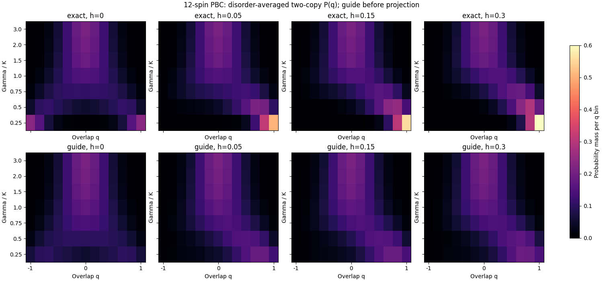

# Ancestry onset and exact overlap-distribution study

2026-10-27T09:32:06.737869+00:00

## Scientific question

Does deterioration of guided-GFMC ancestry as Gamma decreases coincide with changes in physical overlap distributions? Treat this as a hypothesis to test. Ancestry depends on the guide, W, projection time, branch cadence, number of cycles and disorder; it is not an order parameter.

## Exact definition and completed calculation

For two independent z-basis measurements of the same disorder ground state, q = sum_i s_i t_i / N and P_J(q) = sum_(s,t) |psi_J(s)|^2 |psi_J(t)|^2 1[q(s,t)=q]. This is an equal-time measurement distribution, not a decomposition into thermodynamic pure states.

Computed 784 distributions (exact plus available guide distributions) from existing 12-spin (L=2) references. No new diagonalization was needed. Each exact distribution is checked against stored q, q2 and q4, normalization and h=0 spin-flip symmetry. The guide distribution uses the frozen float64 guide before GFMC projection.

All 49 field contexts and eight disorders are exported. Discrete q bins have spacing 2/12. Disorder-average error bars are descriptive SE across disorders; exact diagonalization itself introduces no Monte Carlo error. At h=0 the finite-system P(q) is symmetric; nonzero h can shift and skew it. A 12-spin system has finite-size crossovers, not evidence of a thermodynamic singularity.

## Measured guide mismatch

The table gives the disorder mean of total variation distance, TV = (1/2) sum_q |P_exact(q)-P_guide(q)|. Zero means identical distributions; one means disjoint support. These compare the exact ground state with the unprojected guide, not with a converged GFMC estimate.

| Gamma | h=0 | h=0.05 | h=0.15 | h=0.30 |
|---:|---:|---:|---:|---:|
| 0.25 | 0.49513 | 0.53730 | 0.55328 | 0.56668 |
| 0.5 | 0.21061 | 0.27938 | 0.30861 | 0.33358 |
| 0.75 | 0.11697 | 0.16673 | 0.23454 | 0.28304 |
| 1.0 | 0.05139 | 0.05518 | 0.07719 | 0.14480 |
| 1.5 | 0.01350 | 0.01377 | 0.01378 | 0.01536 |
| 2.0 | 0.00537 | 0.00549 | 0.00543 | 0.00509 |
| 3.0 | 0.00049 | 0.00144 | 0.00153 | 0.00112 |

The guide agrees closely at Gamma >= 1.5, while the mismatch increases at lower Gamma. At h=0 the exact distribution moves toward both overlap extremes; nonzero h favors positive overlap. The guide underrepresents this concentration. This makes guide error a concrete possible contributor to ancestry loss. These 12-spin data cannot establish how much of the 48-spin ancestry loss is caused by guide error or identify a phase boundary.

## Ancestry onset protocol

1. Finish the active base and population/time tests. Report alarm fractions separately for each h and disorder, together with ESS/W, ancestor counts and largest lineage. The existing alarm is ESS < 8 or largest lineage > 0.5 in any cycle. Keep the cycle count fixed for onset comparisons.
2. At h=0 and h=0.05, scan downward from Gamma=2 through 1.75, 1.5, 1.25, 1 and 0.75. Retain Gamma=0.5 as the difficult endpoint. First use the same four fixed development disorders, four repeats, W256 and W1024, equilibration2, measurement1, forward1, cycles4, branch0.1 and float64 guide. New settings remain feasibility diagnostics. This scan is proposed, not dispatched; cost review follows the current escalations.
3. Summarize a diagnostic half-alarm crossing only when complete data bracket alarm fraction 0.5. Interpolate between adjacent tested Gamma values and show per-disorder curves; report nonmonotonicity or multiple crossings instead of forcing a threshold. Refine bracket midpoints only after measuring cost. Confidence assessment must respect disorder clustering; four disorders give limited precision.
4. Test whether the onset moves with W, forward time and guide choice. A moving onset identifies an algorithmic limitation; a stable onset is a candidate region for physical investigation, not proof of a transition.
5. Compare exact P(q), q2, q4 and connected correlations across the same fields. Compare the frozen guide with exact P(q) on each identical 12-spin disorder to diagnose guide mismatch. The current 12-spin and 48-spin disorder pools are different; cross-size comparisons are ensemble comparisons, not paired-sample tests.
6. Add descendant-weighted P(q) histogram tags to a separately validated projector snapshot. Existing scalar q-cycle averages cannot reconstruct P(q). Verify histogram normalization, moments and exact finite-forward targets at L=2 before using it at L=4. Complete convergence and finite-size checks before estimating a physical boundary.

## Refinement and finite-size extrapolation

Use the ancestry bracket to prioritize fields. At each fixed h, obtain qualified Binder and connected-correlation ratios on common field cuts for L=4,6,8,10, then L=5,7,9 with compatible geometry. The 12-spin exact result is a benchmark outside the primary scaling fit. Refine measured physical crossing brackets with common midpoint fields and fresh confirmation disorders. Retain absent or multiple crossings and their bootstrap frequency; do not silently condition the fit on successful crossing samples.

Resample each disorder whole across its field curve and moment set, and independently across sizes. Recompute every crossing jointly so shared-size covariance survives. Conditional fits use Gamma_cross = Gamma_c + A (sqrt(L1 L2))^(-lambda), initially checking fixed lambda=1,2,3. This effective-length ansatz is phenomenological; use compatible pair families, preferably fixed size ratios when available. Vary the minimum size and pair family and report statistical, interpolation, numerical and model sensitivity separately.

The tested utility `finite_size_crossings.py` locates crossings within measured brackets and fits joint bootstrap crossing samples with their covariance. At least three distinct effective lengths are required. Synthetic recovery tests validate the computation, not its physical applicability. Scaling collapse R_L = F((Gamma-Gamma_c)L^(1/nu)) is conditional on evidence for a continuous transition and suitable scaling of the chosen ratio. Sparse sizes may leave both Gamma_c and nu unresolved.

**Current inference status:** no qualified multi-size physical curves are available, so no measured physical crossing, thermodynamic transition estimate or critical exponent is reported. `next_stage_proposal.json` preserves the 448-combination guided onset design and common-size refinement requirements; it is not a dispatched queue. Cost and qualification evidence from the running escalation determine the next executable batch.

## Files

- `exact_and_guide_pq_by_disorder.csv`: every P_J(q) bin.
- `pq_disorder_summary.csv`: equal-weight disorder means and SE.
- `guide_exact_total_variation.csv`: per-context/disorder guide mismatch.
- `ancestry_by_disorder.csv`: field-resolved coverage and alarms, retaining incomplete groups.
- `next_stage_proposal.json`: proposed onset settings and gated finite-size refinement.
- `provenance.json`: input hashes and numerical/scientific limits.
