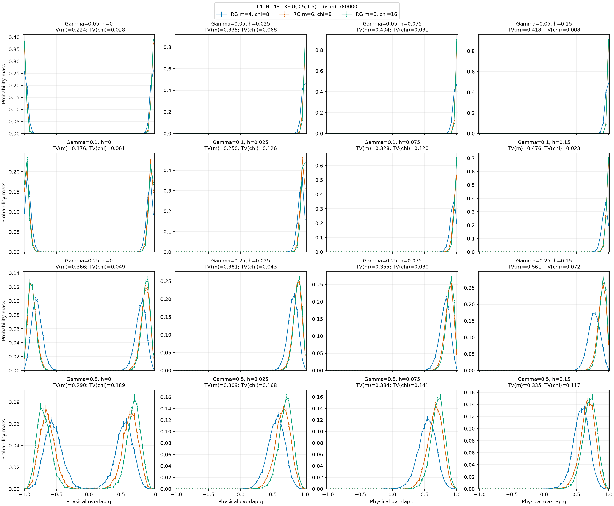
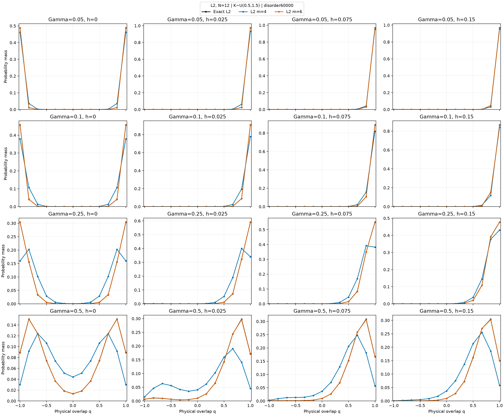
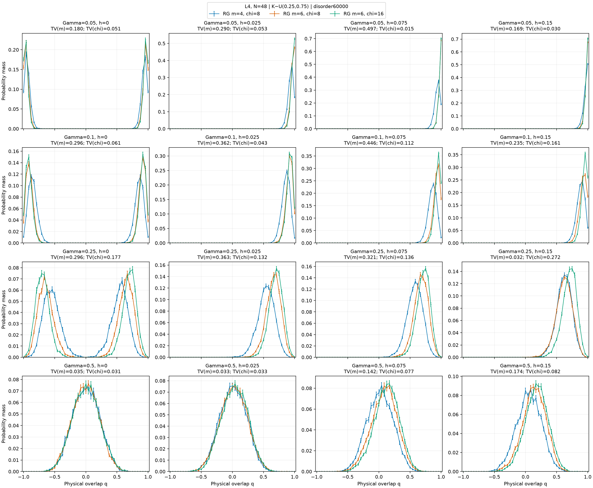
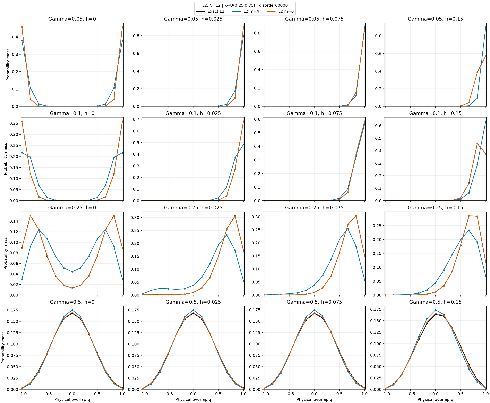
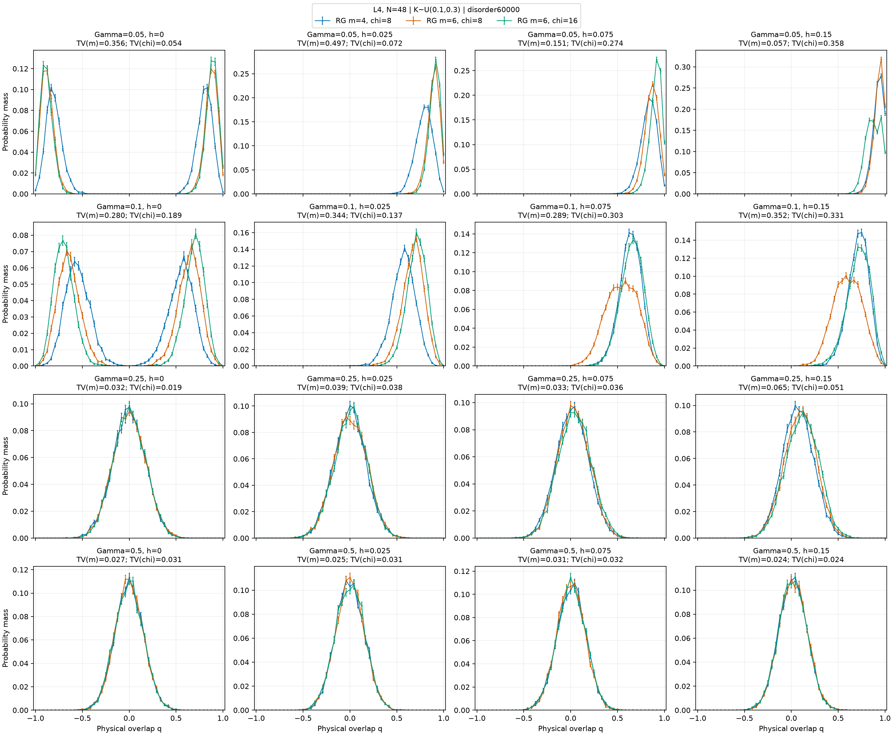
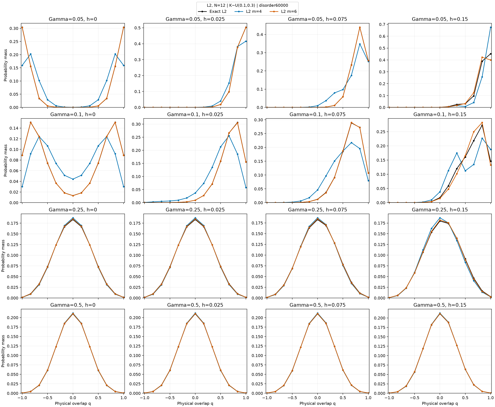
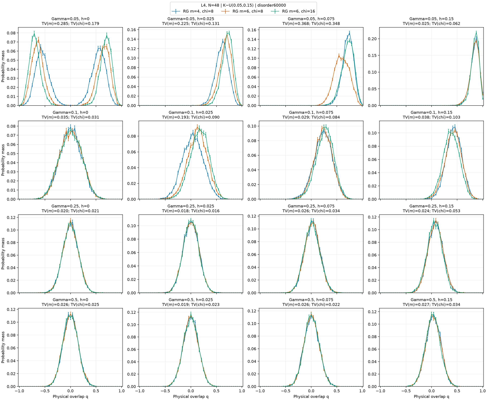
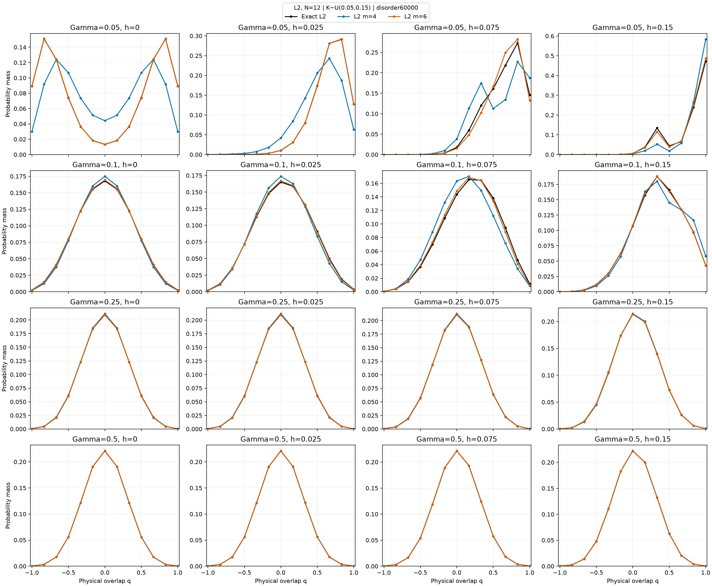
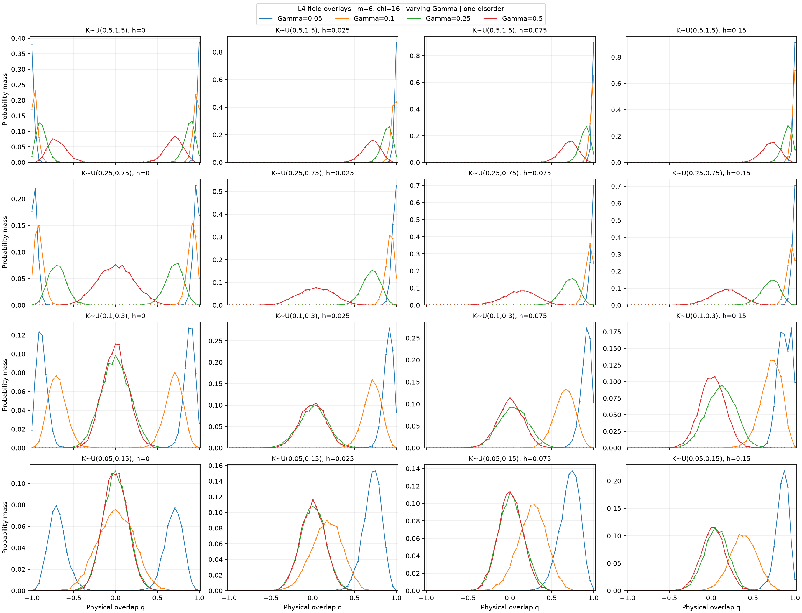
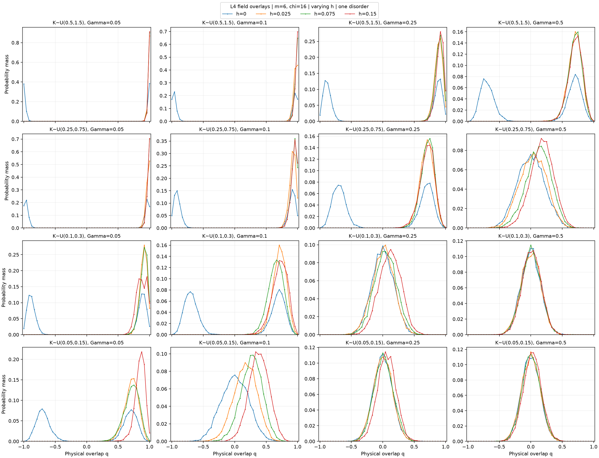

# Lowering both endpoints of every bond distribution

The goal is to locate a candidate field region where RG is stable and physical
$P(q)$ changes, before finite-size scaling of $q_{\rm EA}$ and correlation length.
All bonds use $K=sK^{(0)}$, with $K^{(0)}\sim U(0.5,1.5)$ and
$s=1,0.5,0.2,0.1$. Internal and boundary bonds receive the same factor.
For each size, all contexts share one archived base disorder realization.

Rows: $\Gamma=0.05,0.10,0.25,0.50$. Columns: $h=0,0.025,0.075,0.15$.
L4 contains 48 physical spins. Curves compare $(m,\chi)=(4,8),(6,8),(6,16)$;
8192 independent physical replica pairs give pointwise ±1 sampling SE.
The L2 companion compares the first projection with exact full-spin results;
its disorder differs from L4 because the seed includes size. No full-spin L4
reference is supplied. Retention agreement is a sensitivity screen.

Lowering $K$ at fixed fields changes $\Gamma/K,h/K$. Rescaling all three
together preserves the ground state and truncation difficulty. Energy screens
below divide by the mean bond scale to avoid changing the tolerance merely
by changing the energy unit. At $h=0$, symmetry enforces zero mean overlap for
a nondegenerate exact finite-system ground state, while $P(q)$ and $q^2$ can
still change. Cutoff degeneracies, solver-start disagreement and sampling
alarms are saved and exclude provisional candidates.

## K sampled from U(0.5, 1.5)

| Gamma | h | TV(m) | TV(chi) | chi energy/spin/scale | chi q2 change | Candidate |
| ---: | ---: | ---: | ---: | ---: | ---: | :---: |
| 0.05 | 0 | 0.2242 | 0.0284 | 0.000190 | 0.00308 | no |
| 0.05 | 0.025 | 0.3352 | 0.0684 | 0.000752 | 0.00639 | no |
| 0.05 | 0.075 | 0.4044 | 0.0312 | 0.000422 | 0.00313 | no |
| 0.05 | 0.15 | 0.4177 | 0.0076 | 0.000097 | 0.00088 | no |
| 0.1 | 0 | 0.1758 | 0.0608 | 0.001222 | 0.00817 | no |
| 0.1 | 0.025 | 0.2498 | 0.1257 | 0.001330 | 0.01967 | no |
| 0.1 | 0.075 | 0.3275 | 0.1199 | 0.001408 | 0.01480 | no |
| 0.1 | 0.15 | 0.4761 | 0.0234 | 0.000282 | 0.00195 | no |
| 0.25 | 0 | 0.3656 | 0.0490 | 0.001306 | 0.01186 | no |
| 0.25 | 0.025 | 0.3811 | 0.0433 | 0.001325 | 0.01098 | no |
| 0.25 | 0.075 | 0.3546 | 0.0804 | 0.002870 | 0.01969 | no |
| 0.25 | 0.15 | 0.5610 | 0.0724 | 0.002540 | 0.01765 | no |
| 0.5 | 0 | 0.2904 | 0.1892 | 0.012530 | 0.06489 | no |
| 0.5 | 0.025 | 0.3094 | 0.1677 | 0.011438 | 0.05880 | no |
| 0.5 | 0.075 | 0.3835 | 0.1410 | 0.010991 | 0.05025 | no |
| 0.5 | 0.15 | 0.3346 | 0.1167 | 0.012935 | 0.04399 | no |

## K sampled from U(0.25, 0.75)

| Gamma | h | TV(m) | TV(chi) | chi energy/spin/scale | chi q2 change | Candidate |
| ---: | ---: | ---: | ---: | ---: | ---: | :---: |
| 0.05 | 0 | 0.1799 | 0.0509 | 0.001222 | 0.00817 | no |
| 0.05 | 0.025 | 0.2904 | 0.0530 | 0.000555 | 0.00846 | no |
| 0.05 | 0.075 | 0.4969 | 0.0145 | 0.000282 | 0.00195 | no |
| 0.05 | 0.15 | 0.1694 | 0.0302 | 0.000241 | 0.00446 | no |
| 0.1 | 0 | 0.2964 | 0.0607 | 0.001016 | 0.01382 | no |
| 0.1 | 0.025 | 0.3621 | 0.0432 | 0.001137 | 0.01161 | no |
| 0.1 | 0.075 | 0.4456 | 0.1119 | 0.002266 | 0.02367 | no |
| 0.1 | 0.15 | 0.2349 | 0.1611 | 0.001388 | 0.03536 | no |
| 0.25 | 0 | 0.2959 | 0.1769 | 0.012530 | 0.06489 | no |
| 0.25 | 0.025 | 0.3633 | 0.1321 | 0.010969 | 0.05121 | no |
| 0.25 | 0.075 | 0.3213 | 0.1362 | 0.012935 | 0.04399 | no |
| 0.25 | 0.15 | 0.0320 | 0.2721 | 0.015372 | 0.10794 | no |
| 0.5 | 0 | 0.0350 | 0.0306 | 0.023393 | 0.00067 | no |
| 0.5 | 0.025 | 0.0326 | 0.0331 | 0.023487 | 0.00172 | no |
| 0.5 | 0.075 | 0.1423 | 0.0767 | 0.024201 | 0.00511 | no |
| 0.5 | 0.15 | 0.1744 | 0.0820 | 0.025942 | 0.01046 | no |

## K sampled from U(0.1, 0.3)

| Gamma | h | TV(m) | TV(chi) | chi energy/spin/scale | chi q2 change | Candidate |
| ---: | ---: | ---: | ---: | ---: | ---: | :---: |
| 0.05 | 0 | 0.3560 | 0.0540 | 0.001306 | 0.01186 | no |
| 0.05 | 0.025 | 0.4973 | 0.0719 | 0.002364 | 0.01674 | no |
| 0.05 | 0.075 | 0.1510 | 0.2739 | 0.019345 | 0.07912 | no |
| 0.05 | 0.15 | 0.0574 | 0.3583 | 0.037417 | 0.10014 | no |
| 0.1 | 0 | 0.2803 | 0.1892 | 0.012530 | 0.06489 | no |
| 0.1 | 0.025 | 0.3442 | 0.1366 | 0.012061 | 0.05342 | no |
| 0.1 | 0.075 | 0.2889 | 0.3027 | 0.021019 | 0.11297 | no |
| 0.1 | 0.15 | 0.3523 | 0.3314 | 0.021018 | 0.14766 | no |
| 0.25 | 0 | 0.0322 | 0.0193 | 0.020509 | 0.00009 | no |
| 0.25 | 0.025 | 0.0393 | 0.0380 | 0.022546 | 0.00000 | no |
| 0.25 | 0.075 | 0.0334 | 0.0363 | 0.025463 | 0.00100 | no |
| 0.25 | 0.15 | 0.0653 | 0.0511 | 0.029630 | 0.00439 | no |
| 0.5 | 0 | 0.0269 | 0.0314 | 0.016715 | 0.00003 | no |
| 0.5 | 0.025 | 0.0248 | 0.0311 | 0.016725 | 0.00003 | no |
| 0.5 | 0.075 | 0.0305 | 0.0325 | 0.016892 | 0.00004 | no |
| 0.5 | 0.15 | 0.0236 | 0.0240 | 0.017893 | 0.00001 | no |

## K sampled from U(0.05, 0.15)

| Gamma | h | TV(m) | TV(chi) | chi energy/spin/scale | chi q2 change | Candidate |
| ---: | ---: | ---: | ---: | ---: | ---: | :---: |
| 0.05 | 0 | 0.2850 | 0.1790 | 0.012530 | 0.06489 | no |
| 0.05 | 0.025 | 0.2252 | 0.1307 | 0.014325 | 0.05159 | no |
| 0.05 | 0.075 | 0.3683 | 0.3484 | 0.021018 | 0.14766 | no |
| 0.05 | 0.15 | 0.0249 | 0.0615 | 0.063835 | 0.00807 | no |
| 0.1 | 0 | 0.0354 | 0.0305 | 0.023393 | 0.00067 | no |
| 0.1 | 0.025 | 0.1929 | 0.0903 | 0.025273 | 0.00838 | no |
| 0.1 | 0.075 | 0.0293 | 0.0836 | 0.034310 | 0.01439 | no |
| 0.1 | 0.15 | 0.0383 | 0.1034 | 0.026266 | 0.02923 | no |
| 0.25 | 0 | 0.0195 | 0.0215 | 0.016715 | 0.00003 | no |
| 0.25 | 0.025 | 0.0178 | 0.0157 | 0.016772 | 0.00004 | no |
| 0.25 | 0.075 | 0.0258 | 0.0338 | 0.017893 | 0.00001 | no |
| 0.25 | 0.15 | 0.0236 | 0.0526 | 0.025132 | 0.00191 | no |
| 0.5 | 0 | 0.0259 | 0.0250 | 0.014684 | 0.00006 | no |
| 0.5 | 0.025 | 0.0186 | 0.0233 | 0.014749 | 0.00006 | no |
| 0.5 | 0.075 | 0.0260 | 0.0221 | 0.015264 | 0.00004 | no |
| 0.5 | 0.15 | 0.0267 | 0.0339 | 0.016973 | 0.00037 | no |

## Shifts between neighboring passing panels

| Mean K | Variable | Gamma from/to | h from/to | Change in mean q | Sampling SE | Change in q2 | TV |
| ---: | :--- | :--- | :--- | ---: | ---: | ---: | ---: |

Candidate flags do not certify physical accuracy or a transition. One disorder
and one partition cannot establish glass order. Visible motion may be local
polarization; the field-induced background in $q_{\rm EA}$ must be defined
explicitly. Next validate candidates with higher retention, alternate partitions,
held-out disorder and matched full-spin L4 references before size scaling.
Scaling uses physical L, connected physical correlations and fixed blocking.

Scientific calculations and figure generation ran on AutoDL with one CPU worker.
Raw couplings, seeds, both solver-start states, isometries, spectra, physical
replicas, observables, failures and immutable launch sources accompany the report.
`assessment.json` stores every panel and adjacent field change, including failures
of the retention screen. Energy cutoffs are diagnostic and are not error bounds.

## Zero-field convention and direct field overlays

At $h=0$, every exact and retained eigensolve explicitly restricts global
spin-flip parity to the even sector. This avoids arbitrary asymmetric mixtures
when the finite-system tunnelling splitting lies below numerical resolution.
The archived exact gap is the unrestricted gap, whereas retained gaps at zero
field refer to the even sector. They should not be compared as the same gap.
The unrestricted pilot is preserved separately. At finite longitudinal field,
solves use the full retained space. Near-degenerate cutoff subspaces and solver
start disagreements are retained as alarms.

The overlays use the same saved $P(q)$ measurements as the preceding panels.
They show motion directly; they do not include truncation uncertainty. Consult
the retention tables before using a shift to select a candidate window.

The provisional screen passes 0 of 64 contexts; 0 adjacent field comparisons have both endpoints passing.

No field window is selected by this finite screen. Further retention checks are necessary before finite-size scaling.

| Mean K | Gamma from/to | h from/to | Change in q2 | Sampling SE | Endpoint retention sensitivity sum | Resolved candidate |
| ---: | :--- | :--- | ---: | ---: | ---: | :---: |

A resolved candidate has a q2 shift exceeding three sampling SE plus the sum of the measured q2 retention sensitivities at its endpoints. This is a descriptive screen, not an error bound. Histogram TV also contains a sampling noise floor.
