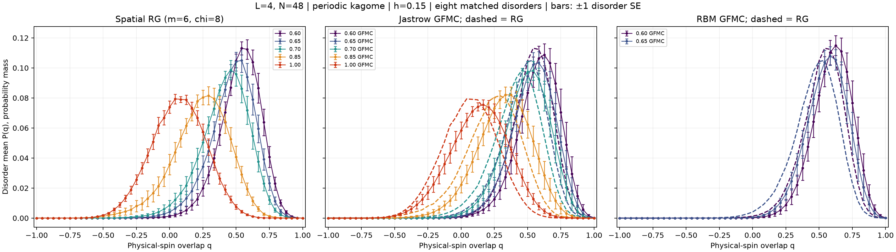

# L4 higher-field physical overlap distributions: spatial RG

Matched to the section “L=4, N=48: higher-field distributions” in
`jastrow_rbm_overlap_distributions.ipynb`. Same five fields, eight disorder IDs
60000–60007, periodic bonds, h=.15 and 49 physical-overlap bins.

48 spins → 16 triangles with m=6 states → 4 superblocks with chi=8 states.
Each superblock basis retains its lowest internal energy states. Two solver
starts and 16,384 independent physical replica pairs per case. Physical joint
Born sampling through the saved isometries gives
$q=N^{-1}\sum_i z_i^{(a)}z_i^{(b)}$. All disorders have equal weight.

Solid curves in the right panels are the frozen GFMC figure inputs; dashed
curves are spatial RG. RBM has complete frozen curves only at .60 and .65.
Bars describe variation across eight disorders; they exclude truncation and
GFMC projection bias. The frozen references retain all ancestry alarms.

**Measured behavior:** the RG curves capture the shift toward lower overlap
and broadening with increasing transverse field, with a systematic shift
toward lower q relative to the frozen GFMC curves. Reproduction is qualitative;
the retained basis remains a significant source of bias. At the highest field
the RG width decreases slightly, whereas the reference width continues to grow.

| Gamma | RG mean q | Jastrow mean q | RG width | Jastrow width |
| ---: | ---: | ---: | ---: | ---: |
| 0.60 | 0.5304 | 0.5809 | 0.1524 | 0.1567 |
| 0.65 | 0.4721 | 0.5393 | 0.1681 | 0.1625 |
| 0.70 | 0.4149 | 0.4926 | 0.1809 | 0.1703 |
| 0.85 | 0.2335 | 0.3206 | 0.2129 | 0.2025 |
| 1.00 | 0.0648 | 0.1346 | 0.2031 | 0.2173 |

| Gamma | Reference | TV of disorder means | Mean paired TV | Delta mean q |
| ---: | --- | ---: | ---: | ---: |
| 0.60 | jastrow | 0.1393 | 0.2013 | -0.0506 |
| 0.60 | rbm_2 | 0.1752 | 0.2234 | -0.0669 |
| 0.65 | jastrow | 0.1574 | 0.2234 | -0.0672 |
| 0.65 | rbm_2 | 0.1976 | 0.2418 | -0.0850 |
| 0.70 | jastrow | 0.1665 | 0.2234 | -0.0777 |
| 0.85 | jastrow | 0.1569 | 0.1836 | -0.0871 |
| 1.00 | jastrow | 0.1402 | 0.1648 | -0.0697 |

| Gamma | TV: m=6 versus m=8, chi=8 | Delta energy/spin |
| ---: | ---: | ---: |
| 0.60 | 0.0197 | -0.000764 |
| 0.65 | 0.0296 | -0.000900 |
| 0.70 | 0.0201 | -0.000984 |
| 0.85 | 0.0244 | -0.001285 |
| 1.00 | 0.0182 | -0.001070 |

TV of disorder means measures agreement of the plotted curves; mean paired TV
also exposes errors that cancel under disorder averaging. Full triangle
retention (m=8, chi=8) is checked for disorder60000 at every field in
`assessment.json`. This is a limited sensitivity check; chi convergence,
partition stability and ground-state qualification remain unestablished.

Raw physical samples, states, isometries, spectra, residuals, source hashes and
failures accompany the report. Scientific computation and figure generation
ran on AutoDL. This comparison does not establish finite-size scaling.

[Raw results and provenance](../data/kagome/triangle_rg_higher_fields_v1/README.md).

