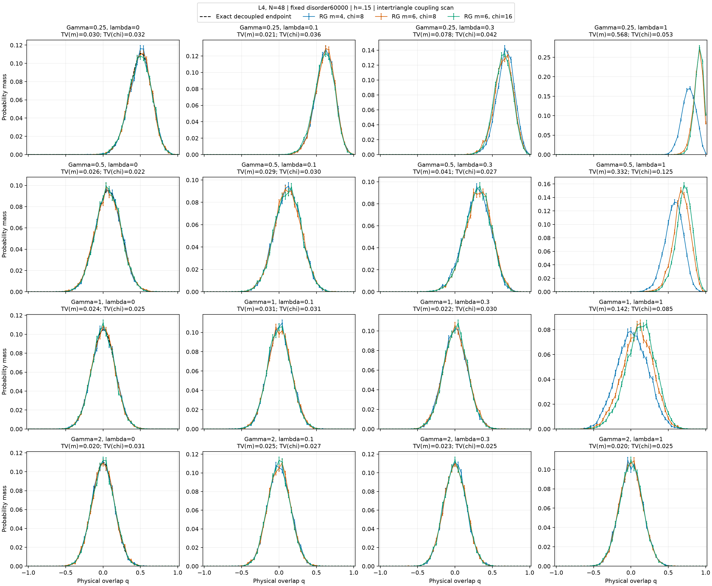
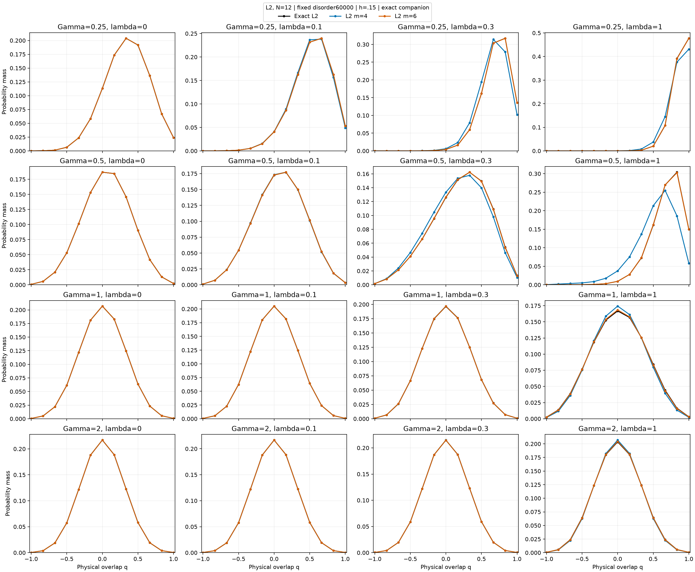
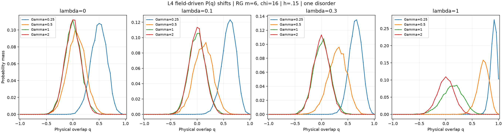

# Weak-intertriangle-coupling screen for spatial RG

The eventual goal is finite-size scaling of $q_{\rm EA}$ and the physical
correlation length in a validated RG regime. This first screen asks whether
physical $P(q)$ still moves with field where retained-space sensitivity is small.

The 4 × 4 layout follows the selected comparison in
`exact_guide_overlap_distributions.ipynb`. Here rows are Gamma=.25,.5,1,2;
columns are lambda=0,.1,.3,1; h=.15. L4 means 48 physical kagome spins.
Original bonds are fixed (disorder60000); only bonds between orientation0
triangles are multiplied by lambda. Internal bonds and fields are unchanged.
The same physical interpolation is used by every retained schedule.

L4 curves compare (m,chi)=(4,8),(6,8),(6,16), with origin(0,0).
Each effective Hamiltonian is solved by Lanczos from two independent starts.
Each curve uses 8192 independent physical replica pairs in two measurement
batches. Bars are pointwise ±1 sampling SE and exclude truncation error.
The black curve at lambda=0 is an exact full-spin product-triangle reference.
At lambda>0 no exact full-space N48 solution or matched GFMC curve is supplied.
Agreement between retained spaces is a sensitivity screen, not an accuracy bound.

The companion uses exact full-space L2 references at identical model parameters
and checks the first projection at m=4,6,8. L2 disorder60000 is a different bond
realization from L4 disorder60000 under the size-dependent disorder generator.
L2 agreement does not certify the L4 superblock truncation. All m=8 projections
must recover their exact reference. Independent physical action tests verify
the bond weighting and projection.

Field shifts are visible directly in the overlay; `assessment.json` stores
paired field changes, their sampling SE, per-panel TV sensitivity, energy and
q2 changes, and exact L2 errors. Its candidate flag is provisional: unresolved
cutoffs or failed screens exclude a panel, and nonpassing points are retained.
The decoupled endpoint has field-driven local changes but no collective
intertriangle transition; motion of P(q) alone does not establish glass order.

Next validate candidate intervals with higher retention, shifted superblocks,
held-out disorders and matched full-spin L4 benchmarks. Refine Gamma/lambda
near the surviving interval before a disorder-averaged size study. At h=.15,
define q_EA with its longitudinal-field background explicitly; a finite-size
raw mean overlap or peak is not automatically a thermodynamic glass order
parameter. Define correlation length from physical connected correlations,
using one fixed Fourier/sublattice convention. Scaling uses physical L and
identical blocking rules, with separate disorder and truncation uncertainties.

All scientific calculations and figure generation ran on AutoDL with one CPU
worker. Raw bonds, modified couplings, states, isometries, spectra, physical
samples, seeds, residuals, failures and source hashes accompany the figures.

## Measured retention screen

| Gamma | lambda | TV(m) | TV(chi) | chi energy change/spin | chi q2 change | Candidate only |
| ---: | ---: | ---: | ---: | ---: | ---: | :---: |
| 0.25 | 0 | 0.0295 | 0.0325 | 0.000000 | 0.00000 | no |
| 0.25 | 0.1 | 0.0208 | 0.0363 | 0.001138 | 0.01190 | no |
| 0.25 | 0.3 | 0.0782 | 0.0419 | 0.006233 | 0.00627 | no |
| 0.25 | 1 | 0.5675 | 0.0531 | 0.002540 | 0.01765 | no |
| 0.5 | 0 | 0.0262 | 0.0222 | 0.000000 | 0.00000 | no |
| 0.5 | 0.1 | 0.0293 | 0.0304 | 0.001420 | 0.00030 | no |
| 0.5 | 0.3 | 0.0410 | 0.0271 | 0.005789 | 0.00317 | no |
| 0.5 | 1 | 0.3317 | 0.1248 | 0.012935 | 0.04399 | no |
| 1 | 0 | 0.0237 | 0.0254 | 0.000000 | 0.00000 | no |
| 1 | 0.1 | 0.0312 | 0.0314 | 0.000256 | 0.00001 | yes |
| 1 | 0.3 | 0.0216 | 0.0302 | 0.002591 | 0.00009 | no |
| 1 | 1 | 0.1420 | 0.0851 | 0.024201 | 0.00511 | no |
| 2 | 0 | 0.0201 | 0.0305 | 0.000000 | 0.00000 | no |
| 2 | 0.1 | 0.0254 | 0.0271 | 0.000302 | 0.00001 | yes |
| 2 | 0.3 | 0.0229 | 0.0245 | 0.002264 | 0.00002 | no |
| 2 | 1 | 0.0195 | 0.0249 | 0.009576 | 0.00002 | no |

## Measured field shifts at m=6, chi=16

| lambda | Gamma change | Change in mean q | Sampling SE | TV between fields |
| ---: | :--- | ---: | ---: | ---: |
| 0 | 0.25 to 0.5 | -0.42687 | 0.00246 | 0.8104 |
| 0 | 0.5 to 1 | -0.06361 | 0.00255 | 0.1674 |
| 0 | 1 to 2 | -0.00331 | 0.00239 | 0.0293 |
| 0.1 | 0.25 to 0.5 | -0.48928 | 0.00242 | 0.8760 |
| 0.1 | 0.5 to 1 | -0.11127 | 0.00262 | 0.2810 |
| 0.1 | 1 to 2 | -0.00344 | 0.00239 | 0.0332 |
| 0.3 | 0.25 to 0.5 | -0.34751 | 0.00228 | 0.7559 |
| 0.3 | 0.5 to 1 | -0.29455 | 0.00262 | 0.6201 |
| 0.3 | 1 to 2 | -0.00501 | 0.00242 | 0.0400 |
| 1 | 0.25 to 0.5 | -0.19798 | 0.00127 | 0.7671 |
| 1 | 0.5 to 1 | -0.58806 | 0.00242 | 0.9424 |
| 1 | 1 to 2 | -0.12060 | 0.00277 | 0.3048 |
