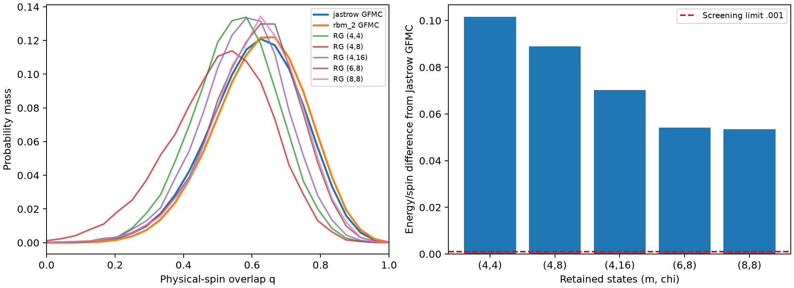

# L4 triangle RG: first benchmark

**The tested fixed low-energy schedule fails the pilot accuracy limits.**

Periodic N=48, disorder60000, Gamma=.55, h=.15; upward triangles, origin (0,0). 48 spins → 16 triangles (m states each) → 4 superblocks (chi states each). Five schedules; two eigensolver starts each; 16,384 independent physical-spin replica pairs per schedule.

| (m, chi) | E/N | ΔE/N vs Jastrow | q² | TV vs Jastrow | TV vs RBM | Total seconds |
| --- | ---: | ---: | ---: | ---: | ---: | ---: |
| (4, 4) | -0.998338 | +0.101626 | 0.319175 | 0.1939 | 0.2328 | 0.62 |
| (4, 8) | -1.010997 | +0.088967 | 0.276359 | 0.2781 | 0.3138 | 1.51 |
| (4, 16) | -1.029644 | +0.070319 | 0.342217 | 0.1261 | 0.1642 | 31.02 |
| (6, 8) | -1.045832 | +0.054131 | 0.379415 | 0.0393 | 0.0650 | 4.34 |
| (8, 8) | -1.046447 | +0.053516 | 0.385980 | 0.0340 | 0.0532 | 59.73 |

Full-spin reference E/N: Jastrow -1.099964, RBM -1.099862. Reference q²: 0.390032, 0.406094, respectively. Each reference averages two main projection repeats. GFMC is comparison data, not exact ground truth.

Screening limits: |ΔE|/N ≤ .001, |Δq²| ≤ .01, TV ≤ .05. All five schedules fail the energy comparison. At fixed chi=8, increasing m improves the overlap; m=8 removes triangle truncation but leaves a large superblock error. The larger-m top subspaces are not necessarily nested.

**Checks passed:** first-level projection for both orientations; full m=8 recovery on exact L2; second-level projection and direct physical-energy reconstruction; same-block two-point products; joint Born sampling of an entangled test state (TV=.00462 with 30,000 draws). L4 bond arrays match regeneration from the archived baseline source; baseline raw hashes verified.

**Interpretation:** low internal superblock energy alone does not select enough states to describe coupling across its boundary. The final eigensolvers converge, but physical truncation bias remains. The isolated-block basis needs a separate accuracy study with more states or an environment-adapted basis.

**Decision:** stop expansion of this schedule. No L6 run. The result does not rule out RG with a different basis. Only one physical context and partition were tested; the full validation grid remains unexecuted.

Raw isometries, states, physical samples, comparisons, conditional sampling uncertainties, failures and source provenance accompany this notebook. Timings exclude baseline verification and validation; they do not establish a speed advantage at matched accuracy.
